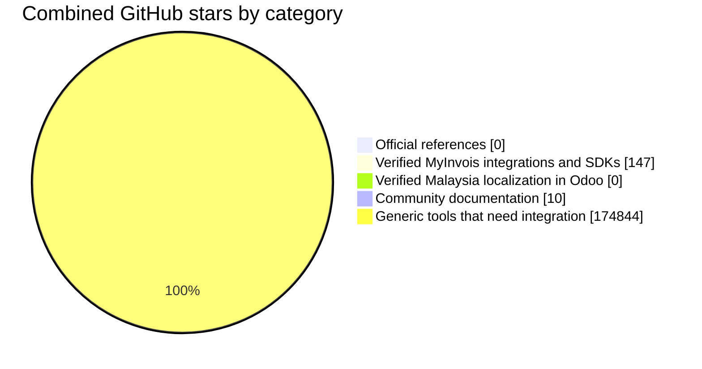

# Awesome Craft Malaysia 

> A curated list of open-source tools useful to Malaysian SMEs, with verified MyInvois support called out separately.

Official LHDN and IRBM documentation is a reference, not an open-source tool. Do not assume a generic ERP, POS or CRM is MyInvois-compliant or SST or EPF localized just because it is open source. For ERPNext, MyInvois support documented here is a separate Frappe app, not ERPNext core. For Odoo, official docs describe submission through Odoo registered as an intermediary on the taxpayer MyTax profile. This research did not find a clearly licensed, clearly maintained complete Malaysian statutory payroll package to list as verified.

## Contents

- [Dashboard](#dashboard)
- [Official references](#official-references)
- [Verified MyInvois integrations and SDKs](#verified-myinvois-integrations-and-sdks)
- [Verified Malaysia localization in Odoo](#verified-malaysia-localization-in-odoo)
- [Community documentation](#community-documentation)
- [Generic tools that need integration](#generic-tools-that-need-integration)
- [Related lists](#related-lists)
- [Star history](#star-history)

## Dashboard

<table>
<tr>
<td align="center"><h2>21</h2>listed projects</td>
<td align="center"><h2>5</h2>categories</td>
<td align="center"><h2>175.0k</h2>combined GitHub stars</td>
<td align="center"><h2>70.0k</h2>combined forks</td>
<td align="center"><h2>10/12</h2>pushed in the last 30 days</td>
<td align="center"><h2>5</h2>languages</td>
</tr>
</table>

**FACT** (snapshot taken 2026-11-15, GitHub API): 21 listed projects, 12 of them on GitHub with public repository statistics. Official documentation and other non-GitHub entries are listed but have no stars, forks or push dates.

**ESTIMATE**: 175.0k combined GitHub stars and 70.0k combined forks, summed from those API counts on the snapshot date. Live star badges next to GitHub entries may differ.

### 🏆 Leaderboard

<table>
<tr><th>Rank</th><th>Project</th><th>Kind</th><th align="right">Stars</th><th></th></tr>
<tr><td align="center">🥇</td><td><b>Odoo Community</b></td><td>ERP</td><td align="right">55.8k</td><td><code>████████████████████</code></td></tr>
<tr><td align="center">🥈</td><td><b>ERPNext</b></td><td>ERP</td><td align="right">41.3k</td><td><code>███████████████</code></td></tr>
<tr><td align="center">🥉</td><td><b>Chatwoot</b></td><td>Support inbox</td><td align="right">39.9k</td><td><code>██████████████</code></td></tr>
<tr><td align="center">4</td><td><b>Invoice Ninja</b></td><td>Invoicing</td><td align="right">10.6k</td><td><code>████</code></td></tr>
<tr><td align="center">5</td><td><b>Akaunting</b></td><td>Accounting</td><td align="right">10.3k</td><td><code>████</code></td></tr>
<tr><td align="center">6</td><td><b>Frappe HR</b></td><td>HR and payroll</td><td align="right">9.1k</td><td><code>███</code></td></tr>
<tr><td align="center">7</td><td><b>Dolibarr</b></td><td>ERP and CRM</td><td align="right">7.9k</td><td><code>███</code></td></tr>
<tr><td align="center">8</td><td><b>klsheng/myinvois-php-sdk</b></td><td>MyInvois SDK</td><td align="right">103</td><td><code>█</code></td></tr>
<tr><td align="center">9</td><td><b>ERPGulf MyInvois</b></td><td>ERPNext MyInvois app</td><td align="right">31</td><td><code>█</code></td></tr>
<tr><td align="center">10</td><td><b>syukranDev/e-invoice-sdk-nodejs</b></td><td>MyInvois SDK</td><td align="right">13</td><td><code>█</code></td></tr>
</table>

### Stars by category

### Licences

   

"Custom" or "None" means GitHub could not match a standard SPDX licence, often because of extra terms or an undeclared licence. Read the project licence before you use it commercially.

## Official references

- [LHDN](https://www.hasil.gov.my/) - The Malaysian tax authority site, including e-invoice guidelines and notices. Prefer current official guideline PDFs over third-party summaries.
- [MyInvois e-Invoice APIs](https://sdk.myinvois.hasil.gov.my/einvoicingapi/) - The official API reference for TIN validation, document submission, cancellation, rejection, retrieval, search and related operations.
- [MyInvois portal](https://myinvois.hasil.gov.my/) - The official taxpayer portal for the MyInvois system. Use the pre-production and production URLs published by LHDN for the environment you intend.
- [MyInvois SDK](https://sdk.myinvois.hasil.gov.my/) - Official LHDN documentation of the APIs taxpayer systems use to integrate with MyInvois.

## Verified MyInvois integrations and SDKs

- [danieyal/myinvois-python](https://github.com/danieyal/myinvois-python) - An unofficial Python SDK for MyInvois, including OAuth2, UBL 2.1 models, signing and submission. The README describes it as beta and not yet verified end-to-end against a live LHDN environment. 
- [ERPGulf MyInvois](https://github.com/ERPGulf/myinvois) - A Frappe and ERPNext app that submits invoices and related document types to the MyInvois APIs. This is a separate app, not the ERPNext core repository. Test in LHDN pre-production before production use. 
- [klsheng/myinvois-php-sdk](https://github.com/klsheng/myinvois-php-sdk) - A PHP client library for the MyInvois APIs. This is an SDK, not an accounting system; you still have to implement document mapping, signing and error handling. 
- [Odoo Malaysia e-invoicing](https://github.com/odoo/odoo/tree/20.0/addons/l10n_my_edi) - The official Odoo l10n_my_edi module for submitting invoices to MyInvois. Official Odoo 20 docs say the taxpayer must add ODOO S.A. as a MyTax intermediary. The module is LGPL-3 in the Community tree.
- [Odoo Malaysia e-invoicing for POS](https://github.com/odoo/odoo/tree/20.0/addons/l10n_my_edi_pos) - The official Odoo l10n_my_edi_pos module for sending POS and consolidated POS invoices to MyInvois, using the same intermediary architecture. Confirm availability in your edition.
- [syukranDev/e-invoice-sdk-nodejs](https://github.com/syukranDev/e-invoice-sdk-nodejs) - A Node.js SDK aimed at LHDN e-invoicing and MyInvois. Verify against the current official API and pre-production before production use. 

## Verified Malaysia localization in Odoo

- [Odoo Malaysia Accounting](https://github.com/odoo/odoo/tree/20.0/addons/l10n_my) - The official l10n_my fiscal localization package. Odoo 20 docs describe default SST taxes and Malaysian company and product fields. This is fiscal localization, not by itself a complete MyInvois integration.
- [Odoo Malaysia Accounting Reports](https://github.com/odoo/odoo/tree/20.0/addons/l10n_my_reports) - Official Odoo 20 docs list SST-02 tax reports under l10n_my_reports. Many Odoo *_reports modules have historically shipped with Enterprise; confirm the edition you are licensed to run.
- [Odoo Malaysia UBL PINT](https://github.com/odoo/odoo/tree/20.0/addons/l10n_my_ubl_pint) - The official l10n_my_ubl_pint module, documented as providing features required to export invoices in PINT format.

## Community documentation

- [myinvois-docs](https://github.com/deadboy18/myinvois-docs) - Community-maintained developer documentation for MyInvois. It is not an official LHDN publication; re-verify operational details against official sources. 

## Generic tools that need integration

- [Akaunting](https://github.com/akaunting/akaunting) - Self-hosted accounting. No MyInvois support is claimed here. 
- [Chatwoot](https://github.com/chatwoot/chatwoot) - A self-hosted customer support inbox. WhatsApp access, when used, should go through Meta official Cloud or Business APIs and is subject to Meta terms. This is not a Malaysia-specific product. 
- [Dolibarr](https://github.com/Dolibarr/dolibarr) - A modular open-source ERP and CRM. No verified MyInvois or Malaysian statutory module is claimed here. 
- [ERPNext](https://github.com/frappe/erpnext) - An open-source ERP with accounting, inventory, CRM and POS. Malaysia MyInvois support documented above is the ERPGulf app, not a feature verified here in ERPNext core. 
- [Frappe HR](https://github.com/frappe/hrms) - Open-source HR and payroll on the Frappe framework. No verified EPF, SOCSO, EIS or PCB implementation is claimed here. 
- [Invoice Ninja](https://github.com/invoiceninja/invoiceninja) - Self-hosted invoicing and client billing. No MyInvois support is claimed here. 
- [Odoo Community](https://github.com/odoo/odoo) - Open-source ERP, CRM, POS and accounting. Malaysia-specific behaviour should be taken from the verified modules above, not assumed for every official app. 

## Related lists

Other lists in the Awesome Craft series:

- [Awesome Craft](https://github.com/EdisonTKPcom/Awesome-Craft) - A curated list of open-source, self-hostable alternatives to popular SaaS tools.
- [Awesome Craft Agents](https://github.com/EdisonTKPcom/Awesome-Craft-Agents) - A curated list of open-source chat apps, coding agents, self-hosted agent bots, workflow automation and image-generation UIs.
- [Awesome Craft AI](https://github.com/EdisonTKPcom/Awesome-Craft-AI) - A curated list of open-source, self-hostable AI runtimes, servers, Hugging Face libraries and related infrastructure.
- [Awesome Craft BSC](https://github.com/EdisonTKPcom/Awesome-Craft-BSC) - A curated list of verified open-source clients, SDKs, dev tools and protocol code for BNB Smart Chain and opBNB.
- [Awesome Craft CUDA](https://github.com/EdisonTKPcom/Awesome-Craft-CUDA) - A curated list of open-source CUDA learning material, kernel libraries, tooling and portability projects.
- [Awesome Craft DeepSeek](https://github.com/EdisonTKPcom/Awesome-Craft-DeepSeek) - A curated list of official DeepSeek repositories and open-source harnesses, serving engines, eval tools and fine-tuning stacks that work with DeepSeek models.
- [Awesome Craft DevOps](https://github.com/EdisonTKPcom/Awesome-Craft-DevOps) - A curated list of open-source, self-hostable alternatives to popular DevOps and hosting SaaS tools.
- [Awesome Craft DNA](https://github.com/EdisonTKPcom/Awesome-Craft-DNA) - A curated list of open-source tools for DNA, genomics and synthetic biology.
- [Awesome Craft Ethereum](https://github.com/EdisonTKPcom/Awesome-Craft-Ethereum) - A curated list of verified open-source Ethereum clients, SDKs, dev frameworks, wallets and security tools.
- [Awesome Craft EV](https://github.com/EdisonTKPcom/Awesome-Craft-EV) - A curated list of open-source software and hardware for electric vehicles and charging.
- [Awesome Craft Hardware](https://github.com/EdisonTKPcom/Awesome-Craft-Hardware) - A curated list of open-source tools for PCB, FPGA, ASIC and chip design.
- [Awesome Craft Hyperliquid](https://github.com/EdisonTKPcom/Awesome-Craft-Hyperliquid) - A curated list of verified open-source SDKs, node tools, analytics and community libraries for the Hyperliquid ecosystem.
- [Awesome Craft Jarvis](https://github.com/EdisonTKPcom/Awesome-Craft-Jarvis) - A curated list of open-source tools to run a personal JARVIS-style AI assistant locally, including dashboards, agent runtimes, voice, MCP connections and memory.
- [Awesome Craft Mars](https://github.com/EdisonTKPcom/Awesome-Craft-Mars) - A curated list of open-source tools and open data for Mars missions and settlement planning.
- [Awesome Craft Neuro](https://github.com/EdisonTKPcom/Awesome-Craft-Neuro) - A curated list of open-source tools for brain-computer interfaces, electrophysiology and neurotechnology.
- [Awesome Craft Robotics](https://github.com/EdisonTKPcom/Awesome-Craft-Robotics) - A curated list of open-source robotics software and hardware, including Microduck, Unitree SDKs, open humanoids, arms, simulation and middleware.
- [Awesome Craft Solana](https://github.com/EdisonTKPcom/Awesome-Craft-Solana) - A curated list of verified open-source Solana clients, SDKs, frameworks, explorers and program libraries.
- [Awesome Craft Space](https://github.com/EdisonTKPcom/Awesome-Craft-Space) - A curated list of open-source tools for spaceflight and rockets, covering orbit simulation, telemetry, launch data and more.
- [Awesome Craft Starlink](https://github.com/EdisonTKPcom/Awesome-Craft-Starlink) - A curated list of open-source tools for Starlink and other LEO satellite internet systems.
- [Awesome Craft Web3](https://github.com/EdisonTKPcom/Awesome-Craft-Web3) - A curated list of open-source DEX protocol code, self-custody software, indexers, frameworks and Blockchain infrastructure.

## Star history

## Contributing

Contributions welcome! Read the [contribution guidelines](contributing.md) first.

If this list is useful, give it a ⭐ so others can find it.

